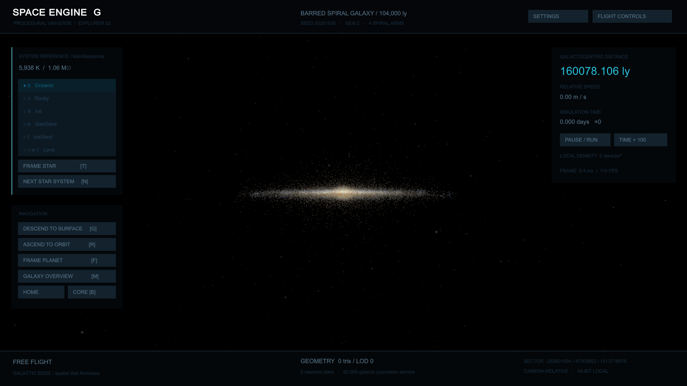
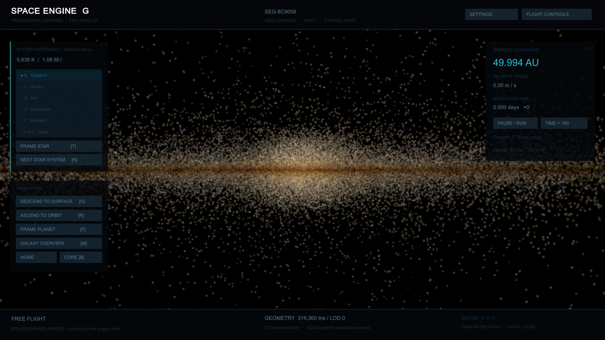
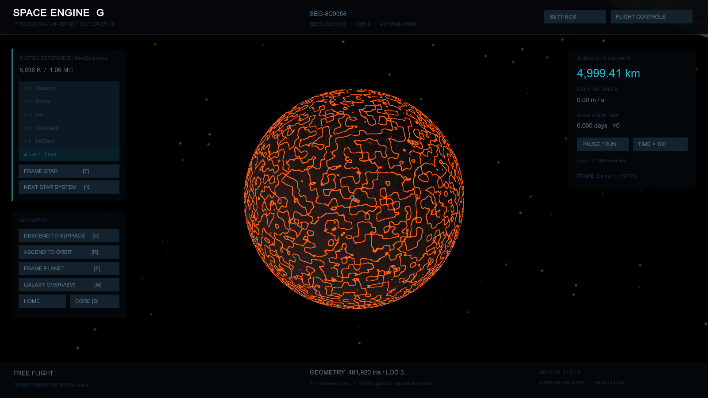

# 0.2.0 验收记录

日期：2026-10-26。本轮交付六分量三维银河和更丰富的天体种群，保留从星际至地表的可运行闭环。证据均由 Unity 或独立程序产生，没有用合成图替代运行截图。

## 版本与阶段

- `72cd657`：银河密度/种群、天体分类、层级轨道及类型地形。
- `838be80`：银河与天体渲染、探索入口、版本 2 存档、测试和 Editor 图形证据。
- 后续修复完成导航终止状态、定位后的速度清零，以及收尾步骤的净空统计。实际分发程序的完整源码提交、构建 GUID 和四个运行时程序集哈希见 [清单](../Artifacts/V020/package-manifest.json)；文档提交可以晚于程序的源码提交。

本地程序：`Builds/Windows-v0.2.0/SpaceEngineG.exe`。分发包：`Builds/SpaceEngineG-0.2.0-windows-x64.zip`。0.1.0 程序、ZIP、存档与证据保留。

## 自动化覆盖

| 系统 | 结果与原始证据 |
| --- | --- |
| EditMode | [88/88 通过](../Artifacts/V020/editmode-tests.json)：高精度坐标、Seed、轨道、密度/分量、种群、地形网格/法线及渲染生命周期。 |
| PlayMode | [14/14 通过](../Artifacts/V020/playmode-tests.json)：原生键盘输入、连续下降、星系流送保留位置、气态接近、卫星位置、真实 GPU 银河顶点、紧凑天体视角和四种参考视角存档。 |
| Shader | [7 个 Shader 验证通过](../Artifacts/V020/shaders.json)。仅作为编译与 Pass 可用性证据。 |
| 大气 GPU | [6/6 通过](../Artifacts/V020/atmosphere-pixels.json)：真空/天空、坐标尺度和近地深度终止。 |
| 天体 GPU | [11/11 通过](../Artifacts/V020/CelestialPixels/celestial-pixels.json)：Seed 重复与差异、模拟自转、冰/气巨星颜色、环覆盖/行星阴影、10 km 云顶细节和夜侧熔岩。熔岩在两三角与 16×16 网格、不同顶点颜色下的图像平均误差约 0.00005。 |
| 独立程序降落 | [通过，退出码 0](../Artifacts/V020/PlayerFlight/runtime-verification.json)：0.03 ly 连续接近至约 2 m，地形达到 LOD 20、微小位移保持可测，切换到已准入的第二恒星系保留观察者位置。另检查已着陆状态与零导航速度。 |
| 独立程序银河 | [通过，退出码 0](../Artifacts/V020/PlayerGalaxy/galaxy-verification.json)：三种银河视角、全部七类行星及七类恒星、卫星、气态接近和中央几何参考面，共 19 张 PNG。两条航线来自同一构建 GUID，均为零运行时错误。 |

## 实际视觉复核

独立程序的 19 张银河/天体截图已逐张查看，降落的六张截图也已查看；Editor 对应截图另行保留。总览可辨认有限旋臂和中心结构，侧视显示盘厚及核球，盘内视角显示尘埃暗带。气态/冰巨星具有不同云带与环，环隙和阴影可辨，熔岩裂隙连续，恒星保留温度颜色差异及表面纹理。黑洞当前是遮挡背景的非发光几何参考面。

首轮自动断言通过，但截图出现巨大散焦光核、漏采尘埃、细环摩尔纹、顶点插值造成的熔岩三角形和缺少近景细节的云顶，保留于 [Iteration01](../Artifacts/V020/Iteration01/README.md)。第二轮修复环和熔岩后，聚合光核亮点与恒星白色过曝仍未通过，保留于 [Iteration02](../Artifacts/V020/Iteration02/README.md)。最终加入角尺寸/补偿上限、薄层内尘埃采样、像素导数过滤、逐片元裂隙/云细节和恒星显示响应。

降落地表截图的近处山坡遮住部分地平线。复核实际 Seed 高度场：此处局部坡度约 25.4°、视线朝上坡方向，地形在前方 50 m 内升高约 14.8 m，中心视线约 3.7 m 就触地。它与新版行星及落点有关；净空、法线和几何计算一致，未用平面替代地形。自动选址/观察方向及近地材料细节仍可改善。

这些是静帧复核，不能证明连续运动的全部 LOD 弹变/闪烁、所有视角或长时间飞行稳定性。

## 性能范围

设备为 NVIDIA GeForce RTX 4070，Direct3D 12；独立程序 1600×900，Editor 截图 1920×1080。程序关闭 vSync 并设置 120 FPS 上限。最终降落 318 步，平均帧间隔 **8.398 ms**、P95 **8.688 ms**、最大 **9.072 ms**，最终净空约 **1.999998 m**；银河巡检的各截图点平滑帧间隔 **8.382–8.790 ms**。确切值和内存/几何数据以两个原始 JSON 为准。

银河默认 60,000 个空间光核（120,000 个三角形），视点外部没有伪造的局部恒星系；起始系统邻域约 217 个已准入单星系统。默认两颗巨行星的云层参考网格各 384×192，环角向细分 512。巡检截图点 Unity 总已分配内存峰值约 **188.4 MB**；这不是操作系统 RSS，也不包含完整显存/驱动开销。数据是启用/驻留几何计数，不等同于经过 GPU 遮挡与视锥剔除后的绘制计数。

降落按固定 0.15 s 虚拟步驱动，用于快速检查连续坐标和流式生成。帧间隔测量实际渲染/运行开销，包含程序与调度；不代表真实旅行时间。截图点为平滑帧间隔，主航线另有原始样本 P50/P95/最大值；截图等待和冷启动不纳入该主航线统计，起始截图仍可能出现较高的平滑值。没有 GPU 时间戳测量，不能从 120 FPS 封顶结果推断更多性能余量。

## 模型与未覆盖边界

银河包含薄盘、厚盘、旋臂、核球、棒和恒星晕，属于可探索的合成空间结构。60,000 个聚合光核与局部每 4 ly 格最多一个已解析恒星系，不等同于完整观测星表或逐颗实例化银河所有恒星。未实现双星、星团/星云、卫星星系、银河引力势/旋转、恒星演化及多星系宇宙学。最高速飞行时，4 Hz 局部流送会跳过短暂经过的区域；银河投影每帧更新，尚未验收逐格横穿整个银河。

云顶地平线仍有几像素的网格分段；银河具有可见的聚合颗粒感；海岸线较粗；岩石、冰、沙漠的远景材质仍有相似的颗粒法线外观。固体地形暂不随自转旋转。地形 LOD 使用裙边，尚无完整形变过渡。900p 次级 HUD 字体较小、较暗。

云带是程序化外观而非流体求解；气态安全边界约 10 km，不提供固体降落。大气仍是单次散射和统一参考系数，未校准每种天体的大气成分；没有天气或体积云。银河尘埃为十次采样 RGB 近似，曝光与角尺寸经过显示处理，非绝对测光。黑洞没有透镜、吸积或相对论轨迹。视角快捷定位不冒充连续跨银河飞行。

存档采用生成版本 2，保留版本 1 原文件而不迁移；银河结构在配置/启动时应用，直接原位修改运行中的结构参数不自动重建。当前未覆盖其他 GPU、移动端、XR、极端自定义参数及长时间内存稳定性。

研究依据与采用边界见 [技术调研](RESEARCH.md)、[架构](ARCHITECTURE.md) 和 Core 的 GALAXY/POPULATION 说明。后续优先优化地形材料/LOD、云顶解析几何与银河细节，再加入星图、星团/星云和长期航行验收。
