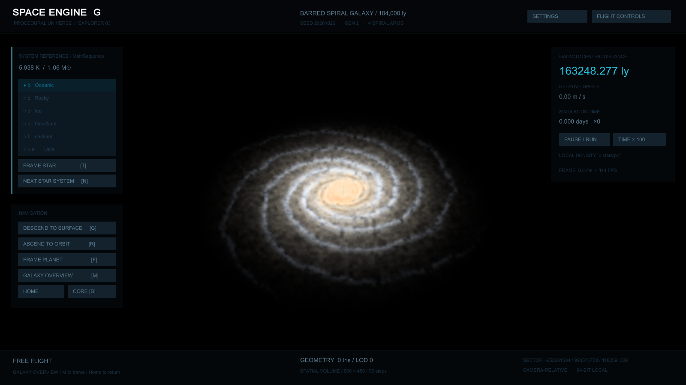
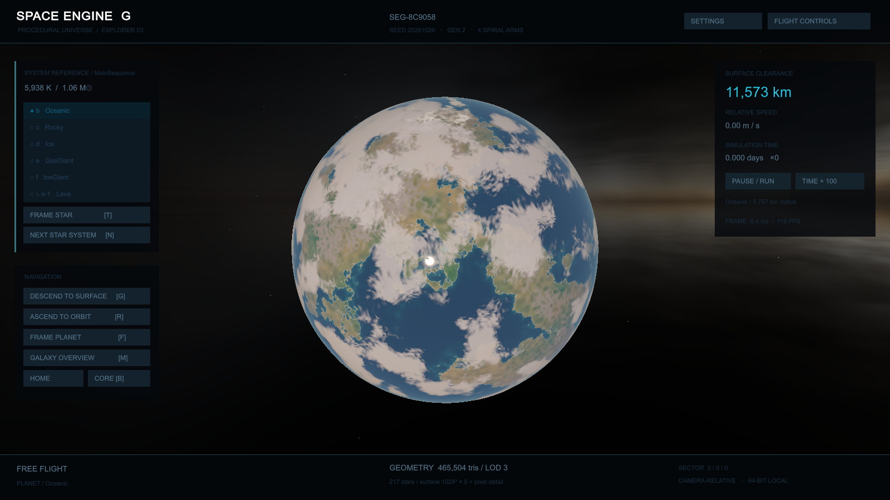
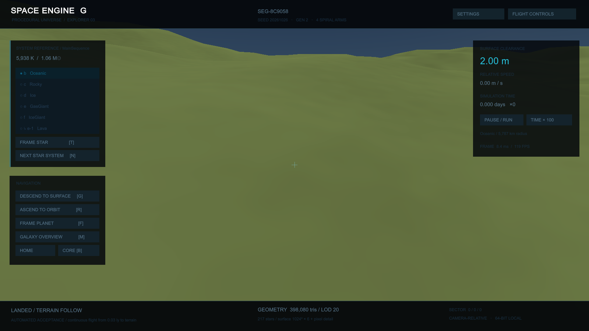

# 0.3.0 行星与银河渲染验收

日期：2026-10-26 至 27 日。本轮针对低分辨率材料、银河点云观感与近景轮廓进行修改，保留确定性生成、高精度坐标及连续降落。所有展示图均来自真实 Unity / Windows 程序，没有使用合成概念图。

## 实现变化

- 固体天体延迟烘焙六面 RFloat 高度材料图，默认 1024²/面，支持到 2048²/面；逐像素求海岸、材料、过滤法线和海洋反射。地面细节使用有界米制坐标及解析噪声梯度，与轨道贴图采样解耦。
- GPU 高度使用原 CPU 地形的 64 位哈希与参数；几何、碰撞、天体 Seed 和生成版本 2 不变。没有通过换地形掩盖材料问题。
- 银河在实际观察者位置积分有限三维发光与尘埃场，默认半分辨率 HDR / 96 步；原人口光核降为细节点源。支持内外曝光、对比度、采样和质量参数，静止缓存、姿态改变重算。
- 海洋星球增加轨道薄云，气态云带改为多尺度扭曲湍流；气态参考球通过解析命中重建颜色、法线与深度，近景轮廓不再由参考网格弦面决定。
- 地形与气态天体补齐 Forward+ / SSAO 实际需要的 `DepthNormalsOnly`。旧的单独 `DepthOnly` 通过不能保证游戏中的 `_CameraDepthTexture` 已包含天体。

## 证据索引

107/107 EditMode、17/17 PlayMode 通过，10 个 Shader 所有检查通过。八套 GPU 像素菜单合计 65 个断言通过，其中五项精度断言在地面及地面＋大气场景中复用。Editor 两条实际航线均通过、零运行时错误。

程序源码提交为 `b97dc9819bac0b6fef2191b00edb4482b91561f8`；两条独立航线构建 GUID 同为 `6cfd34d330ca4aa888ab769729cc2dee`，均退出 0、零运行时错误。Windows 构建成功，0 错误、2 个 Shader 警告（整数除法性能及 pow 输入静态分析）；输入曝光和积分辐射在代码中限制为非负，未发生非有限像素。ZIP 共 40,311,059 字节，SHA-256 为 `77758b5ec3dddafaecab93758e36e05bfd60599fc745b44f7b09daaf7487c071`；解包完整性检查通过。

| 范围 | 原始证据与覆盖 |
| --- | --- |
| Unity 原生测试 | [EditMode](../Artifacts/V030/editmode-tests.json)、[PlayMode](../Artifacts/V030/playmode-tests.json)：完整原系统回归、GPU/CPU 高度及 64 位哈希、资源生命周期、地图集成、云淡出、小旋转缓存与存档。 |
| Shader 编译 | [10 个 Shader 及变体](../Artifacts/V030/shaders.json)，包括 RGB 消光和法线 oct 编码；这是编译证据，不能替代画面。 |
| 大气/原天体 GPU | [大气](../Artifacts/V030/atmosphere-pixels.json)、[天体](../Artifacts/V030/CelestialPixels/celestial-pixels.json)。 |
| 地表 GPU | [材料](../Artifacts/V030/TerrainPixels/terrain-pixels.json)、[真实尺度地面](../Artifacts/V030/GroundPixels/ground-pixels.json)、[地面与大气组合](../Artifacts/V030/GroundAtmospherePixels/ground-pixels.json)。后者复用五项精度断言，再检查真实深度覆盖和大气横带。 |
| 云与气态轮廓 GPU | [薄云](../Artifacts/V030/CloudPixels/cloud-pixels.json)、[解析轮廓与实际相机深度/法线](../Artifacts/V030/GasHorizonPixels/gas-horizon-pixels.json)。 |
| 银河 GPU | [空间积分与合成](../Artifacts/V030/GalaxyPixels/galaxy-pixels.json)：位置/Seed、采样收敛、盘厚、盘内暗空、尘埃、零曝光、合成方向及不透明遮挡。 |
| 实际 Editor 航线 | [连续降落](../Artifacts/V030/Flight/runtime-verification.json)、[银河与天体](../Artifacts/V030/Galaxy/galaxy-verification.json)。 |
| 独立 Windows 航线 | [连续降落](../Artifacts/V030/PlayerFlight/runtime-verification.json)、[银河与天体](../Artifacts/V030/PlayerGalaxy/galaxy-verification.json)，退出码与截图在同目录。 |
| 分发包 | [构建、程序集哈希、GUID 与 ZIP SHA-256](../Artifacts/V030/package-manifest.json)，源码提交在 [source-revision.txt](../Artifacts/V030/source-revision.txt)。 |

## 发现并修复的问题

1. 初始 GPU 噪声在负格点的角点进位丢失，导致材质高度与 CPU 场不一致。完整 64 位梯度哈希对照定位到进位，用有界 16 位相加修复，保留严格高度阈值及精确边界测试。
2. D3D Blit 与场景网格的 Y 方向不同，银河合成上下翻转。用真实 URP 深度 fixture 和独立辐射图对照修复；盘内灰白底随后通过曝光/对比度和暗空断言修正。
3. 实际云层过白、沙漠层理像等高线，按全游戏截图调整覆盖、厚度和轨道材料频率；不靠通过孤立 fixture 宣称视觉达标。
4. 地面用单位方向的屏幕导数恢复物理切向量，在厘米像素下遭遇 float 量化。真实行星尺度 fixture 准确复现，改为相机相对位置求足迹、噪声解析梯度求微法线。棋盘残差从约 0.031987 降至 0.0000121，2 mm 位移图差从 0.0582 降至 0.0000211，两倍渲染比例图差为 0。
5. 地面仍有纯水平雾带。实际 Forward+ 相机深度覆盖为 0，因 Shader 缺少 SSAO 所需的 DepthNormalsOnly；补齐后覆盖恢复为 100%，组合图相邻行最大大气跳变从约 0.013719 降至 0.00000535。没有通过关大气或关闭 SSAO 绕过。
6. 原银河缓存使用 Unity 近似 Quaternion `==`，120 帧慢转动仅重算 102 次。改为精确组件比较，增加 0.02° 转动回归；持续运动基准要求至少 118 次重算。
7. 新气态深度 fixture 首先因手工 CommandBuffer 使用错误逻辑 clear depth 而未绘制。独立平面、两种 clear、禁深度控制和 CPU clip oracle 将其定位；引擎逻辑远深度 clear 为 1。此后真实 URP 相机纹理另行验证，避免手工绘制通过但预通道缺失。
8. URP 在本机为法线目标选择 `R8G8B8A8_SNorm`。初版测试把 CPU 理想 round-to-nearest 当成 GPU 唯一结果，错误拒绝合法量化；逐像素样本定位后，保留理想舍入差值供诊断，正式断言依据 [DirectX 规范的 FLOAT→SNORM 0.6 ULP 容差](https://microsoft.github.io/DirectX-Specs/d3d/archive/D3D11_3_FunctionalSpec.htm#3.2.3.4%20FLOAT%20-%3E%20SNORM) 和 [D3D12 官方常量](https://github.com/microsoft/DirectX-Headers/blob/main/include/directx/d3d12.idl) 检查所有有效像素的最大分量误差。轮廓和深度的独立 double 参考门槛保持不变。RenderGraph 返回后的默认全局纹理格式不能用作当帧真实目标格式证据。

早期失败报告与图见 [Iteration01](../Artifacts/V030/Iteration01/)、[Iteration02](../Artifacts/V030/Iteration02/README.md)、[近地精度失败](../Artifacts/V030/GroundPixels/OriginalDirectionNormals/ground-pixels.json) 及 [缺深度预通道](../Artifacts/V030/GroundAtmospherePixels/MissingDepthNormals/ground-pixels.json)。

## 性能与限制

设备为 RTX 4070 / Direct3D 12，独立程序 1600×900、120 FPS 上限。Editor 为 1920×1080，不能直接混用帧耗时。

| 独立程序范围 | 实测结果 |
| --- | --- |
| 连续降落 318 步 | 平均 8.740 ms，P95 8.715 ms，最大 120.999 ms；最终净空约 1.999998 m，LANDED、速度为零。均值略高于 P95 是少数尖峰造成。 |
| 银河持续转动 120 帧 | 平均 8.343 ms，P95 8.356 ms，最大 8.559 ms；体积积分实际重算 119 次，非仅测缓存。 |
| 银河/天体静止截图点 | 平滑帧间隔约 8.33–8.77 ms；不代表首次烘焙成本。 |
| 首次海洋行星接近 | 140 帧窗口平均 30.72 ms，最大 **3092.08 ms**。原始失败性能边界保留，不能只报告 120 FPS。 |
| 相同二进制再启动重测 | [追加报告](../Artifacts/V030/galaxy-performance-repeat.json)：海洋行星接近最大 **180.96 ms**，其余固体接近最大约 53.76–71.70 ms；银河转动平均 8.349 ms、P95 8.420 ms、最大 8.860 ms。退出 0、零错误；诊断截图保留在本机 `Artifacts/Local/v030-galaxy-repeat/`，没有替换首轮最终证据。 |
| 内存与目标尺寸 | 巡检点 Unity 总已分配内存峰值约 195.0 MB（186.0 MiB）；起始系统全部已访问高度图估算合计 128 MiB，选中地图 32 MiB；银河目标 800×450、96 步。这些指标不等于总显存。 |

连续降落统计包含实际帧间隔；银河另有持续运动及重算次数。天体巡检首次接近的 140 帧窗口包含资源/管线首次使用和地图准备，不是纯 GPU 烘焙时间。重复启动仅说明这次尖峰较小，未建立首次 3 秒停顿的具体 CPU/驱动/GPU 因果；没有 GPU 时间戳或清空驱动缓存的对照。首次进入仍会卡顿，分帧烘焙与管线预热是后续性能工作，不能声称已修复。固定 0.15 s 虚拟步驱动的降落用于验证吞吐和坐标，不代表实际旅行时长。未测其他显卡。

1024² × 6 高度图含 mip 估算约 32 MiB/固体天体；访问后的同系统地图保持驻留直到换系统。`totalMaterialMapBytes` 是这些地图的估算总量，Unity 已分配内存不是 OS RSS 或总显存。首次全六面烘焙仍可能造成帧尖峰，尚未分帧调度。

这次是明确的渲染改进，仍未达到 SpaceEngine 的整体视觉水平。有限高度图在轨道仍有采样极限；近地有程序化材料和真实几何，但未加入地表岩石/植被、侵蚀与完整 LOD 形变。银河为合成密度场，仍可见规则旋臂骨架和低分辨率体积重建，没有观测尘埃图、绝对测光或散射。海洋薄云在进入前淡出，没有体积穿云和地表云影。气态近景是解析球面上程序化光学外观，没有体积气象或可降落地面。大气仍为单次散射，黑洞仍无相对论透镜。截图复核不等同于所有运动帧、任意 Seed 或长期飞行稳定性验收。

## 实际截图复核

最终独立程序的 20 张银河/天体截图、6 张降落截图已逐张打开复核，并与 0.2 对应图比较。银河从大颗粒人口点云改为连续亮臂和尘带，外部中心保留暖色；海岸不再沿网格形成大三角，薄云窗口可看到下方陆地。气态原同心靶纹改为不规则气带/云胞，环的遮挡、间隙和阴影保留；10 km 近景长跨度轮廓台阶消除。地面蓝绿随机法线和纯水平大气硬带在最终程序中均未出现，沙漠轨道虫纹消除，未见地形裂缝或贴片接缝。

仍可直接看到的不足：2 m 地面偏单色、材料层次较弱；大气内截图部分位置被奶灰薄云遮挡；巨行星轨道偏暗、部分云纹斑驳，近云顶仍低对比；熔岩为近等宽橙色线条，偏风格化；核区黑洞背景有大面积奶油色高亮。恒星本体与 0.2 基本相同，未增加日冕或紧致星专属外观。这些固定视角复核不覆盖所有运动帧或任意 Seed。

