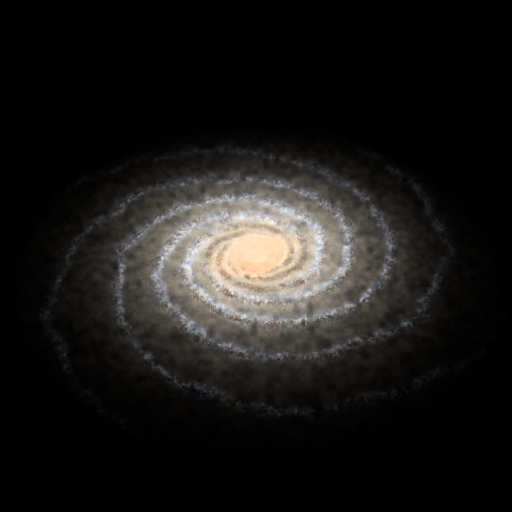
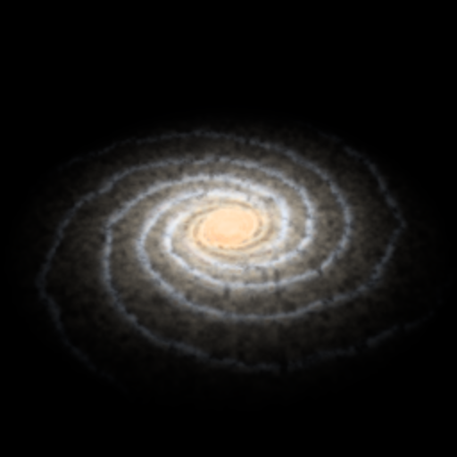
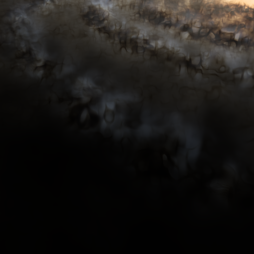
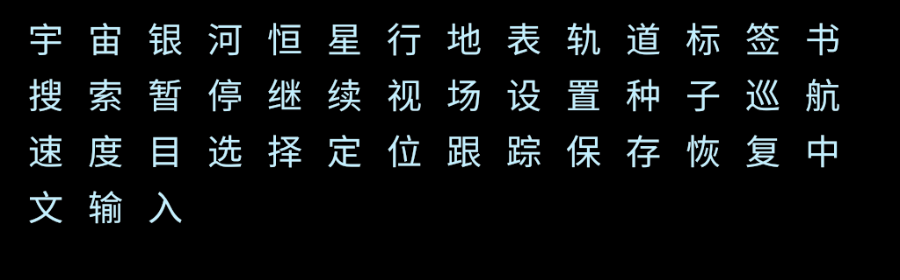

# 0.4.0 银河清晰度与连续探索验收

日期：2026-10-27。本文分别记录 Unity Editor、GPU 读回和独立 Windows 实际游戏航线；视频与分发包结果在文末补充。本轮没有使用外部银河背景图，也没有把编译通过当作画面验收。

## 实现变化

- 银河默认由半分辨率提高至原生分辨率，外部积分由 96 步提高至 128 步，盘内至少 224 步。增加 Seed 驱动的三维分子尘丝与年轻星团细节频段；细节跟随银河实际坐标，接近旋臂时改变角尺度和透视。按像素与射线步长过滤未解析频率，没有采用屏幕锐化或放大恒星光斑。
- 对进入观察者附近 8000 光年的积分区间分配较多采样，保留原薄尘层区间划分及有限银河边界。薄盘、厚盘、旋臂、核球、棒和晕的基础密度模型与目录准入保持原有定义。
- 地形增加可逆父子三角形形变与 LOD 滞回。子块起点重现实际父三角形的几何、法线、材料颜色和原始高度，颜色、深度与深度法线使用同一形变。运行时默认每级过渡 0.35 s、合并滞回 20%；静止后的收敛同时检查网格队列与未完成过渡。
- 增加天体搜索、类型筛选、鼠标选中、目标居中/跟踪、真实开普勒轨道线、恒星系总览、位置书签和截图。选中目标和居中分别保留位置；`G` 连续飞往，`F` 跳转观察，恢复书签属于显式位置跳转。搜索覆盖本恒星系与已解析邻域，可添加有效生成单元地址，最多显示距离最近的 256 项，不是完整观测星表。
- 界面、类型、状态、帮助与探索工具改为中文，随包提供 OFL 的 Noto Sans CJK 字体。滚轮支持 Windows 120 单位和每格 1 单位设备，巡航设置与实际速度分别显示。
- 世界生成版本仍为 2；权威地形高度、扇区加 double 坐标、连续碰撞/降落及存档坐标语义保留。银河、地形质量和光学参数仍可配置。

银河主要默认值为 `GalaxyResolutionScale=1`、`GalaxyVolumeSamples=128`、`GalaxyInteriorSamples=224`、`GalaxyDetailStrength=1`、`GalaxyDetailScaleLy=360`、`GalaxyNearDetailDistanceLy=8000`。低分辨率仍可作为性能选项。实现和采样边界见 [银河渲染说明](../SpaceEngineG/Assets/SpaceEngine/Rendering/GALAXY-VOLUME.md)、[地形说明](../SpaceEngineG/Assets/SpaceEngine/Terrain/README.md)。

## 证据索引

130/130 EditMode、22/22 PlayMode，共 **152/152** 通过，无跳过；11 个 Shader 的检查通过。新增银河清晰度 10 项、地形 LOD 8 项和中文字体 4 项 GPU 断言均通过，原银河空间积分与合成 14 项继续通过。地形 LOD 的 8 项和原地表材料的 5 项属于不同 fixture。

| 范围 | 原始证据与覆盖 |
| --- | --- |
| Unity 原生回归 | [EditMode](../Artifacts/V040/editmode-tests.json)、[PlayMode](../Artifacts/V040/playmode-tests.json)：生成、坐标、轨道、LOD 形变/滞回、渲染生命周期、目标选择、速度和书签等。 |
| Shader 编译 | [11 个 Shader](../Artifacts/V040/shaders.json)，新增轨道线 Shader；编译结果只证明当前设备的编译/变体检查。 |
| 银河清晰度 | [10 项 GPU 检查](../Artifacts/V040/GalaxyClarity/galaxy-clarity.json)及同目录 9 张可比图，原生/半分辨率、细节开关、双质量参考、真实近臂与盘内观察者。 |
| 银河空间和合成 | [14 项 GPU 检查](../Artifacts/V040/GalaxyPixels/galaxy-pixels.json)：Seed/位置、收敛、薄盘、尘埃、盘内暗空、零曝光、不透明深度和合成方向。 |
| 地形时间连续性 | [8 项 GPU 检查](../Artifacts/V040/TerrainLodPixels/terrain-lod-pixels.json)：实际地球尺度 L14 父块/L15 子块、形变端点、小步、静止、反向、Forward+ 深度法线。 |
| 原地表精度回归 | [逐像素材料](../Artifacts/V040/TerrainPixels/terrain-pixels.json)、[真实尺度地面](../Artifacts/V040/GroundPixels/ground-pixels.json)、[地面＋大气](../Artifacts/V040/GroundAtmospherePixels/ground-pixels.json)。 |
| 中文字形 | [4 项 GPU 检查](../Artifacts/V040/ChineseGlyphPixels/glyph-pixels.json)：内嵌字体、45 个不同汉字的实际 atlas、可见墨迹和透明间隙；不代替全界面布局复核。 |
| 原天体效果回归 | [大气](../Artifacts/V040/atmosphere-pixels.json)、[天体](../Artifacts/V040/CelestialPixels/celestial-pixels.json)、[云](../Artifacts/V040/CloudPixels/cloud-pixels.json)、[气态轮廓/深度法线](../Artifacts/V040/GasHorizonPixels/gas-horizon-pixels.json)。 |
| 实际 Editor 航线 | [固定虚拟步连续降落](../Artifacts/V040/Flight/runtime-verification.json)、[银河/天体巡检与运动视角](../Artifacts/V040/Galaxy/galaxy-verification.json)、[探索工具功能](../Artifacts/V040/Explorer/explorer-verification.json)、[真实墙钟往返降落](../Artifacts/V040/EditorContinuous/explorer-verification.json)。报告均通过、零运行时错误；截图在各自目录。连续航线单独归档，避免被功能重跑覆盖。 |

下面 GPU 数字取自 `2026-10-26T19:54Z` 批次，设备为 Unity 6000.5.7f1 / RTX 4070 / Direct3D 12。Editor 航线的构建 GUID 为全零，不能用作独立程序二进制身份。

## 银河清晰度：可比 GPU 结果

原生与半分辨率控制保持相同 Seed、观察者、投影、曝光及三维场。基准原生图为 512²/128 步；参考为 1024²/256 步并缩小比较。近臂使用实际 Seed 旋臂位置与 192/384 步，盘内使用 224/448 步。高频对比、参考误差与孤立亮点同时检查，不能仅凭噪点增加宣称细节提升。

| 检查 | 实测 | 门槛 |
| --- | ---: | ---: |
| 默认实际目标宽度 | 512 px | 512 px |
| 原生相对参考误差 / 半分辨率相对参考误差 | 0.335466 | < 0.94 |
| 细节开启/关闭的高频结构比 | 1.587689 | > 1.05 |
| 原生与双质量参考的平均绝对图差 | 0.00232318 | < 0.025 |
| 孤立高亮噪点 | 0 | < 20 |
| 接近实际旋臂后的细节/关闭高频比 | 6.003973 | > 1.08 |
| 近臂 192/384 步平均绝对图差 | 0.000630976 | < 0.035 |
| 盘内实际使用的积分步数 | 224 | 224 |
| 盘内细尘开启/关闭高频比 | 1.447680 | > 1.04 |
| 盘内 224/448 步平均绝对图差 | 0.00279590 | < 0.035 |

这些归一化线性读回指标证明当前控制中的解析结构和收敛情况，不等于绝对天文光度或主观画质得分。

9 张清晰度 fixture 图已逐张打开复核。原生图相对半分辨率与细节关闭控制有更清楚的蓝白年轻星团、尘带缝隙；近臂和盘内出现更细的空间丝状结构。没有出现空白、巨型散景点或靠孤立亮噪点增加高频的情况。

仍有直接可见的缺陷：旋臂骨架过于规则，局部近似同心排列；近臂及盘内尘丝有较多闭合泡状、蜂窝状轮廓，能辨认连续噪声等值面的程序纹理。提高分辨率解决了重建模糊，不能消除密度场形态本身的局限。没有据此宣称达到 SpaceEngine 的银河视觉质量。全游戏航线 PNG 已产出，其最终独立程序与运动视频复核另列于文末。

## 地形形变与中文字形

地形 GPU fixture 使用实际 CPU 地形、生产材料/高度图及 Forward+ 深度法线通道，不以纯数学插值代替提交后的图像。父子起点颜色图差为 **0.00000186968**，深度图差为 **0.000000303240**；小形变步图差 **0.0000110143**，完整子块相对起点图差 **0.0155140**。静止重复和反向返回图差均为 **0**，深度随完整形变的差值为 **0.0131855**。8 项断言全部通过，表明当前固定视角中起点衔接与形变连续；完整运动中的裂缝、跳动和地表观感仍需视频检查。

实际墙钟探索航线完成首次降落、上升和沿原径向回程，未用位置摆放代替这三段运动。[单独归档的 Editor 连续航线报告](../Artifacts/V040/EditorContinuous/explorer-verification.json)记录两次落地静止合计 **8.010 s / 960 帧**，可见地形表示变化 **0 次**；回到同一路径的位置误差为 **0.005157 m**。固定虚拟步的原降落航线另完成 318 步，最终净空 **1.999998 m**。真实墙钟航线和固定虚拟步航线的时间意义不同。

字体 fixture 实际渲染 1024×320 GPU 图。45 个请求汉字均有不同字形区域、可见墨迹和形状间隙，4 项断言通过；字体名为 `NotoSansCJKsc-Regular`。此检查能排除把所有汉字渲染成同一缺字方框，不能验证所有 Unicode 字符、输入法或任意窗口尺寸的排版。

## 性能与边界

以下均为本机 Editor 结果，不能与上一版独立程序的 1600×900 数据直接比较。同步 GPU 读回计时包含分配、提交和 GPU 等待，没有 GPU 时间戳；报告也注明 Shader 缓存可能已被前面的菜单预热。

| 范围 | 实测及含义 |
| --- | --- |
| 512²/128 步原生银河 | 本批首次分配/积分/读回 19.169 ms；三次强制重积分分别 15.260 / 13.599 / 23.747 ms。强制失效避免只测静止缓存。这里的“首次”不代表清空驱动缓存后的冷启动。 |
| 256²/128 步半分辨率控制 | 7.806 ms；原生清晰度有实际成本，不能把质量提高说成免费。 |
| 512²近臂、盘内 | 近臂 192 步 24.598 ms；盘内 224 步 24.146 ms，均含同步读回。 |
| 双质量参考 | 1024²/256 步 152.996 ms；属于验证参考，不是默认运行预算。 |
| 1920×1080 银河持续转动 | 120 帧、119 次实际重积分；平均 8.924 ms、P95 14.936 ms、最大 18.895 ms。静止截图点约 8.3 ms 不能代替这一运动数据。 |
| 固定虚拟步连续降落 | 平均帧间隔 22.347 ms、P95 48.696 ms、最大 68.065 ms，包含 Editor/流送开销，不是实际旅行时长。 |
| 实际探索往返航线 | 初始/中间 settling 抽样最大 775.712 ms，回程降落抽样最大 **919.252 ms**。采样窗口可能包含阶段边界的截图读回；保留停顿数据，不据此推断普通飞行单帧成本。本记录未建立 CPU/驱动/GPU 的具体因果，独立程序全帧视频另测。 |
| 首次接近与内存 | 银河巡检的海洋星球接近窗口最大 78.168 ms；材料图仍为 1024²×6 含 mip 约 32 MiB/固体天体，访问 4 个固体后估算合计 128 MiB。不是总显存。 |

原生银河 HDR 目标只计算颜色纹理时，1920×1080 的 ARGBHalf 约为 15.82 MiB，1600×900 约为 10.99 MiB，不含深度、相机目标、网格、驱动和其他效果。静止缓存可以减少积分次数，但转动、移动、视场/参数变化均需重算。独立 Windows 的冷启动、首次地图烘焙、运动银河和长时稳定性仍需单独记录，不能从 120 FPS 上限推断已经解决卡顿。

功能边界也保持明确：目录是确定性合成系统而非观测全星表；导航是可控运动学飞行而非飞船动力学；银河仍无观测尘图、绝对测光和尘埃散射，晕积分较粗。气态巨行星无固体地表，薄云没有体积穿云，恒星没有新增日冕，黑洞仍只有几何视界，没有相对论透镜。地形形变改善时间连续性，不能代替侵蚀、植被、岩石资产或任意 Seed/所有 LOD 边界的逐帧验证。

## 独立 Windows、视频与交付记录

### 独立程序截图复核

源码 `02be496` 重建后，三条独立 Windows 航线报告使用同一构建 GUID `12402545998548b1a16b4a562a1d8459`：[银河与天体](../Artifacts/V040/PlayerGalaxy/galaxy-verification.json)、[探索工具与往返飞行](../Artifacts/V040/PlayerExplorer/explorer-verification.json)、[原连续降落](../Artifacts/V040/PlayerFlight/runtime-verification.json)均通过，错误数均为 0。下面的视觉结论来自实际打开 PNG，不只读取这些通过标记。

前一构建 GUID `98c0a9f365694c0fb98e973409479b5d` 的 20 张银河/天体 PNG 已逐张打开复核，原图和报告保留在 [前轮归档](../Artifacts/V040/PreviousRuns/20261026T204026Z-7df3fd3f/PlayerGalaxy/galaxy-verification.json)。最终重建保留核心天体渲染，针对标签遮挡和避让，再实际打开了下面 5 张图；没有把这次定向复验写成最终构建全部 20 图或视频逐帧复核。

| 最终构建实际图片 | 复核结果 |
| --- | --- |
| [海洋行星](../Artifacts/V040/PlayerGalaxy/04-oceanic.png) | 原先叠在海洋星球右侧陆地上的后方冰巨星标签已消失，选中海洋星球的标签仍保留。海岸、薄云、反射和银河背景正常，未见背景覆盖行星。 |
| [银河斜视](../Artifacts/V040/PlayerGalaxy/01-galaxy-oblique.png) | 原生细尘/年轻星团清晰度保留，暖核与暗空正常；没有多余目标标签或轨道线覆盖银河。旋臂仍偏规则、近似同心排列。 |
| [银河侧视](../Artifacts/V040/PlayerGalaxy/02-galaxy-edge.png) | 薄盘、核球和尘带正常，未出现 UI 标签或轨道线残留；中心亮度仍较高。 |
| [银河盘内](../Artifacts/V040/PlayerGalaxy/03-disk-from-within.png) | 盘内透视和尘带保留，目标栏及侧栏可读；仍有闭合环状尘纹、水平细条与柔软远场，没有据此宣称盘内观感已完成。 |
| [中文恒星系轨道总览](../Artifacts/V040/PlayerExplorer/04-orbital-system-cn.png) | 实际轨道线可见，中心恒星、行星及卫星标签分开排布，必要时使用引线；此视角未见重叠文字或标签侵入侧栏。固定视角不覆盖任意相机与窗口尺寸。 |

前轮完整巡检中，各类天体均正常显示，未见粉色 Shader、空白或明显几何裂缝。仍有明确不足：气态云纹偏斑块且较暗，云顶近景低对比；熔岩为较等宽的橙色闭合线；恒星类型主要以物理参数和颜色区分，没有新增日冕或紧致星专属外观；核区背景仍大面积奶油色高亮，黑洞没有相对论透镜。最终 5 图复验没有扩大这些已知限制的验证范围。

Windows Shader 警告另作只读核查：`GalaxyVolume.shader` 的 `_SampleCount/5` 为常量非零分母，样本在 CPU 端限制为 32–512，属于整数除法性能提示。255 行的 `pow` 输入警告没有发现有效参数下的 NaN 路径：`GalaxyVolume.Tick` 实际上传前限制曝光非负、内外曝光为正、对比度为 1–3；Shader 先将辐射限制为非负，故 `1-exp(-intensity*displayExposure)` 在 0–1。没有仅凭 Inspector 的 Range 或忽略警告作此结论，也没有为消除静态分析提示改动已验收二进制。

### 最终构建与性能

构建前源码提交为 `02be496a763288407a3fa2f1894b6e5e02014d8b`，三条路线GUID均为 `12402545998548b1a16b4a562a1d8459`。Unity6000.5.7f1构建成功，耗时8.93秒、错误0、警告2（上文已核查），详见[构建报告](../Artifacts/V040/build.txt)。最终源码另用Unity命令行重跑：[EditMode XML](../Artifacts/V040/final-editmode.xml)130/130、[PlayMode XML](../Artifacts/V040/final-playmode.xml)22/22通过，无跳过。

实际设备为RTX4070 / Direct3D12，窗口1600×900，帧率上限120、VSync关闭。三个独立进程均正常退出0、运行时错误0；[汇总](../Artifacts/V040/windows-verification.json)与各目录日志/退出码保留。下面是实际帧间隔，包含流送与运行环境，未使用GPU时间戳。

| 独立程序范围 | 平均 / P95 / 最大帧间隔 |
| --- | --- |
| 固定虚拟步星际到地表，318步 | 17.482 / 35.009 / 123.767 ms；最终净空1.999998m。最终重跑在Unity测试进程退出后进行，避免并行图形测试污染计时。 |
| 银河持续转动，120帧、119次重积分 | 8.410 / 8.707 / 8.761 ms；1600×900原生体积纹理。 |
| 首次海洋星球接近窗口 | 平均10.137ms，最大213.626ms；冷接近尖峰未解决，静止缓存帧不能代表首次地图烘焙成本。 |
| 录制中的首次连续下降，0.1秒采样175次 | 23.430 / 42.538 / 44.871 ms，包含原生读回/编码开销。 |
| 录制初始化/收敛，0.1秒采样25次 | 最大574.254ms，可能包含阶段截图读回，不作普通连续飞行成本或具体CPU/GPU因果结论。 |

原生录像实际读取1499帧、按墙钟重复55帧，合计1554帧；缓冲队列最大1。累计ReadPixels及CPU复制14.520秒、单次最大97.870ms，录制有额外成本，不能据此推断未录制游戏的GPU耗时。两段静止合计8.005秒、951个实际游戏帧、几何变化0；沿径向返回位置误差0.0004603m。这些是默认Seed和固定航线结果，不代表任意Seed/所有边界已验证。

银河巡检的Unity分配统计约177.4–218.2MB，固定航线约177.8–200.8MB；不是操作系统RSS或总显存。材料高度图仍为每固体天体约32MiB。每条原始报告保留计量范围。

### 分发与复现

本地ZIP为 `Builds/SpaceEngineG-0.4.0-windows-x64.zip`，**53,954,753字节**，SHA-256：`1409a7af063256e7e6e01e8191e36609accc74e99b03c827e6008ab587394259`。[分发清单](../Artifacts/V040/package-manifest.json)包含194个运行文件、程序集/播放器哈希及视频哈希。ZIP全条目校验通过，附字体OFL和来源声明；旧版本ZIP保留，二进制包不纳入Git源码。

`python Scripts/verify_windows.py`可重跑三条路线，Explorer通过验证专用CLI启动游戏帧缓冲录制。`python Scripts/review_video.py`进行全流解码、逐秒抽样、同帧PNG比较及联系表输出。`python Scripts/package_windows.py`要求最终XML、87项GPU结果、三报告同GUID、两段稳定停留、完整视频解码及06–09同帧内容/方向比较均通过后才打包。

首次窗口抓取因DX12合成不能可靠获取游戏内容，已判无效并改用原生ReadPixels加后台rawvideo管道。错误视频只保留于忽略目录 `Artifacts/Local/CaptureFailures`，未当作交付证据；失败元数据和其他早期路线归档在 `PreviousRuns`。最终录像没有剪掉初始化黑场，实际抽样缺陷见下文。

首次失败和修复回归保留在 [地形初次测试](../Artifacts/V040/terrain-initial-tests.json)、[地形修复测试](../Artifacts/V040/terrain-fixed-tests.json) 和 [首次 PlayMode 结果](../Artifacts/V040/Iteration01/playmode-tests.json)，没有仅留下最终通过结果。

## 独立视频：逐秒抽样与同帧截图复核

本节对应最终构建 GUID `12402545998548b1a16b4a562a1d8459` 的 [原生实际游戏视频](../Artifacts/V040/PlayerExplorer/descent.mp4)、[录制元数据](../Artifacts/V040/PlayerExplorer/capture-metadata.json)及[原生帧/截图索引](../Artifacts/V040/PlayerExplorer/native-video.json)。使用 `python Scripts/review_video.py` 完成全流解码、逐秒抽帧及指标计算；[原始复核报告](../Artifacts/V040/VideoReview/video-review.json)记录视频 SHA-256、命令输出来源、时间映射、每帧指标和图像路径。

FFmpeg 完整解码退出 0，共 **1,554 帧 / 51.800 秒 / 1600×900 / 30 fps**，与原生编码帧数一致。原生录制包含 **1,499 次实际读帧、55 帧重复补齐**；因此编码 30 fps 不等于每个时间槽都有新画面，也不能据此宣称无停顿。视频 PTS 0 使用 `native.firstFrameEpoch`，报告相位按 `report.utc + elapsed` 映射，时间锚不确定度为 **±0.1 秒**。07/09 对照直接使用原生截图的精确视频帧索引，不依赖这个估计。

实际逐张打开以下 **4 张联系表、共 52 个逐秒样本**，以及两组同帧 PNG/视频全景及 2 倍地形裁剪对照：

| 联系表 | 视频范围 | 直接观察 |
| --- | --- | --- |
| [第 1 张](../Artifacts/V040/VideoReview/20261026T204600.767611Z-e51c25a7/contact-sheet-001.png) | 00:00–00:15 | 00:02 初始化 settling 样本中，景物区域全黑而 HUD 仍显示；00:03 恢复。首次连续下降自约 00:04 开始，随后依次出现云/地表与近地起伏。黑场没有删帧或以通过结果掩盖。 |
| [第 2 张](../Artifacts/V040/VideoReview/20261026T204600.767611Z-e51c25a7/contact-sheet-002.png) | 00:16–00:31 | 首次近地下降、约 00:23–00:26 静止及随后上升；抽样中未见闪洞或整片地形突换，静止样本外观稳定。 |
| [第 3 张](../Artifacts/V040/VideoReview/20261026T204600.767611Z-e51c25a7/contact-sheet-003.png) | 00:32–00:47 | 上升至约 2 km 后原路返回；远近地形轮廓随观察高度变化，抽样中未见透空、错误材质或整片跳换。 |
| [第 4 张](../Artifacts/V040/VideoReview/20261026T204600.767611Z-e51c25a7/contact-sheet-004.png) | 00:48–00:51 | 返回地面后的第二次静止外观稳定；后续 12 个空格只是联系表不足 16 个样本的占位。 |

静止指标只计算 **x=512…1039、y=504…773** 的中央下方地形区域，避开默认 HUD、顶部目标条、底栏和准星；不以包含变化帧耗时文本的全画面差异判定地形抖动。避开相位边界后，首次静止取 24/25/26 秒、第二次取 49/50/51 秒。归一化 RGB 相邻样本最大平均绝对差分别为 **0.000236442 / 0.000229730**；各段最后两个样本裁剪解码后完全相同。小差异包含 H.264 量化影响，不能据此确定所有变化的物理原因。独立程序自身报告另记录两次静止合计 **8.005 秒 / 951 游戏帧、表示变化 0 次**，沿原路径返回的位置误差 **0.0004603 米**。

| 同阶段对照 | 精确视频帧 | 地形裁剪实测与观察 |
| --- | --- | --- |
| [07 首次静止对照](../Artifacts/V040/VideoReview/20261026T204600.767611Z-e51c25a7/07-first-surface-hold-comparison.png) | 801，00:26.700 | PNG/视频方向一致；正常 RGB 平均绝对差 0.00604582，整幅垂直翻转控制 0.0670915，红蓝交换控制 0.0953509。 |
| [09 返回静止对照](../Artifacts/V040/VideoReview/20261026T204600.767611Z-e51c25a7/09-return-surface-hold-comparison.png) | 1553，00:51.7667 | PNG/视频方向一致；正常 RGB 平均绝对差 0.00604592，整幅垂直翻转控制 0.0670925，红蓝交换控制 0.0953528。 |

两组实观对照均未见上下颠倒或红蓝互换；视频略暗、细节略软，正常平均差约为 **1.54 个 8 位色阶**，不等于无损匹配。地表仍大面积呈低对比绿色，云层近看仍有大块灰米色覆盖；稳定性改进没有消除这些既有美术与天气模型限制。

此处是**完整解码检查 + 逐秒人工抽样 + 两组精确同帧对照**，不是 1,554 帧逐帧人工验收。00:04–00:51 抽样未见闪洞或整片突换，不能排除采样间隔内的短暂 LOD 跳动、小裂缝或重复帧造成的停顿；初始化黑场已明确保留。脚本的 `pipelineSucceeded` 只表示解码、抽样和证据覆盖流程完成，不代表画面美观或全程视觉无缺陷。
