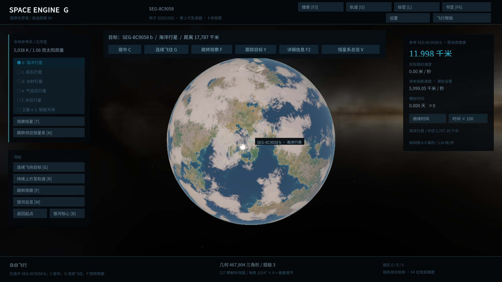
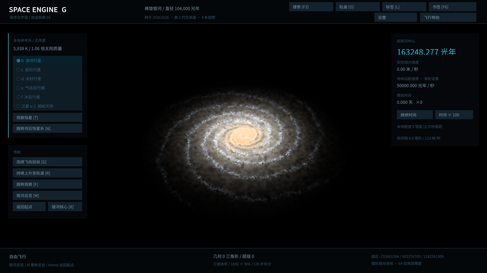

# SpaceEngineG

Unity 6 / URP 程序化宇宙探索器。使用真实米制半径与轨道距离、高精度扇区坐标和自适应球面地形，可从星际空间连续飞到程序化地表。

这是可运行的早期探索版本；基础系统与图形验证证据随源码维护，尚未达到 SpaceEngine 的天体种类、画面质量和科学完整度。

当前迭代 **0.4.0**：中文界面、天体搜索与筛选、目标选择/跟踪、真实轨道、标签、详情和书签；修复不同设备的滚轮调速，增加截图和时间倍率快捷键。银河使用原生视口分辨率及更细的空间尘埃结构；地形以父子三角形渐变与迟滞抑制 LOD 突变和阈值附近反复切换。

**130 项 EditMode、22 项 PlayMode 与全部 87 项 GPU 断言通过**，包含实际中文字形、银河清晰度、父子 LOD 图像连续性和真实行星尺度的近地深度/大气检查。当前证据位于 [Artifacts/V040](Artifacts/V040/)；同一构建的三条独立 Windows 路线均通过，零运行时错误，已保存35张截图和51.8秒原生帧缓冲录像。[0.4实测记录](Docs/VALIDATION-V040.md)分别登记自动断言、截图、录像抽样与已知缺陷。





## 启动

使用 Unity Hub 打开仓库中的 **`SpaceEngineG/`** 子目录，版本 **6000.5.7f1**。载入 `Assets/Scenes/Universe.unity` 后按 Play。项目已包含入口场景、资源材质和默认配置，无需下载美术包。

若需重建场景/默认资源，运行菜单 `Space Engine > Setup Explorer Scene`。Windows 打包菜单为 `Space Engine > Build Windows Explorer`，输出 `Builds/Windows-v0.4.0/SpaceEngineG.exe`。

本地交付包为 `Builds/SpaceEngineG-0.4.0-windows-x64.zip`，解压后运行其中的 `SpaceEngineG.exe`，保留同目录数据和 DLL。二进制不提交 Git；源码用户按上述菜单构建。

| 0.4.0 最终交付项 | 状态 |
| --- | --- |
| 独立程序三条路线、退出码及运行时错误 | 全部通过，退出码0、错误0；构建GUID见[清单](Artifacts/V040/package-manifest.json) |
| 连续下降/静止/上升/原路返回视频及实际复核结果 | [51.8秒原生录像](Artifacts/V040/PlayerExplorer/descent.mp4)，1554帧全流解码；两次静止951帧无几何切换，返回误差0.46毫米；逐秒抽样记录见实测文档 |
| ZIP 大小、SHA-256 与分发清单 | 53,954,753字节（53.95MB），[SHA-256清单](Artifacts/V040/package-manifest.json)，完整ZIP校验通过 |

旧版程序、ZIP 和证据保留；[0.3 实测记录](Docs/VALIDATION-V030.md)及其[分发包清单与 SHA-256](Artifacts/V030/package-manifest.json)仅说明 0.3 的交付状态。

## 操作

| 操作 | 按键 |
| --- | --- |
| 前后左右飞行 | WASD |
| 上下移动 / 翻滚 | E、Q / Z、X |
| 转动视角 / 绕选中目标观察 | 右键拖动 / Alt + 右键拖动 |
| 设置待命巡航速度 / 加速 | 滚轮或 +、- / Shift |
| 选择天体 | 左键点天体，或点击列表/搜索结果 |
| 搜索与筛选 / 目标详情 | F3 / F2 |
| 目标居中 / 开关目标跟踪 | C / Y |
| 连续飞往目标并下降或接近云顶 / 连续上升 | G / R |
| 显式跳转至目标观察位置 | F |
| 显示轨道 / 显示标签 / 恒星系总览 | O / L / V |
| 书签列表 / 添加当前位置书签 | F6 / Ctrl + B |
| 保存截图 | F7 |
| 下一颗行星或卫星 / 跳转邻近恒星系 | Tab / N |
| 跳转观察当前恒星 / 银河总览 | T / M |
| 返回起始系统 / 中央黑洞参考面 | Home / B |
| 关闭面板或取消导航 / 暂停时间 | Esc / Space |
| 减慢 / 加快模拟时间 | [ / ] |
| 保存 / 恢复飞行状态 | F5 / F9 |
| 显示或隐藏界面 | F1 |

**选择只更换目标**；C 只转动视线、保持观察者位置，Y 持续跟踪目标方向。G/R 连续更新同一高精度观察者坐标，F、Tab、N、T、V、M、Home、B 及恢复书签属于显式位置跳转。右侧高度遥测注明实际参考天体；选中目标可以与参考天体不同。轨道默认关闭，O 开关、V 总览自动开启。气态/冰巨星没有固体降落面，接近停在可配置的云顶安全净空。探索器允许超光速移动，未实现相对论飞行动力学。

F3 搜索覆盖**当前恒星系及实际已解析邻域**，可按中文名称/种类、可降落、海洋、大气、卫星及距离筛选，并通过单元地址 `x,y,z` 加入确定性生成的恒星系；结果最多显示最近 256 项。这不是对整个银河全部恒星的索引搜索。滚轮兼容每格 **1 unit** 与 Windows **120 unit** 输入，默认每格倍率 1.6；遥测分别显示待命巡航速度和实际速度。鼠标位于面板时滚轮用于界面，搜索/书签或种子输入期间屏蔽飞行按键。F7 截图保存至程序数据目录的 `Screenshots`，界面提示实际路径。

银河拥有薄盘、厚盘、旋臂、核球、棒和恒星晕，默认盘直径 104,000 光年。在实际观察者位置积分空间发光及尘埃透射，默认采用**原生视口分辨率、银河外部 128 步、盘内 224 步**；近观察者 8,000 光年优先分配积分预算，以米制世界中的空间结构生成约 360 光年尺度的细尘埃、暗带及恒星形成区。60,000 个三维小光核补充未解析恒星人口细节，局部目录按同一个密度模型准入。视角真正静止时复用结果，位置或旋转改变时重算；运动性能单独记录。它们具有空间位置和视差，尚未逐颗实例化银河全部恒星。黑洞目前显示几何参考面，尚无透镜或吸积盘。

固体星球保留 **1024² × 6 面 GPU 高度材料图**及逐像素海岸/地质/米制细节，可配置到每面 2048²；海洋星球使用薄云层，气态巨星以解析球面命中重建近景轮廓。地形细化从父三角形插值位置、法线和外观连续渐变到子网格，合并可反向过渡；默认 20% 迟滞、0.35 秒过渡，防止阈值抖动反复切换。CPU 高度、碰撞和可降落几何仍保留；完整生成版本保持 2，兼容原地形及存档。

游戏内右上角“设置”支持调整曝光、视场、恒星亮度、地形预算及宇宙种子。银河采样/分辨率/细节/内外曝光、LOD 迟滞/过渡、材料图分辨率/法线/海洋反射、云覆盖/厚度/风、大气及安全净空参数位于 `SpaceEngineG/Assets/SpaceEngine/Resources/UniverseSettings.asset`；细环、裂隙和 Shader 参数位于同目录材质。银河总览有单独视场控制。参数在启动时复制，游戏内调整不会覆盖源配置；材料图分辨率在首次烘焙时应用。

中文使用随项目捆绑的 **Noto Sans CJK SC Regular** 静态字体；字体和 [SIL OFL 许可证](SpaceEngineG/Assets/SpaceEngine/Resources/Fonts/OFL-NotoSansCJK.txt)可再分发，Windows 包中保留 `ThirdPartyNotices`。中文字形通过动态字库及实际 GPU 像素验证，不依赖操作系统安装字体。

生成版本 2 使用 `flight-v2.json`，保存银河参数与当前参考视角。旧 `flight.json` 保留，使用 0.1.0 程序打开；不会把新世界地形套在旧存档上。

## 验证

Unity Test Runner 包含 EditMode 数学/网格测试和 PlayMode 集成测试。菜单还提供：

- `Space Engine > Validate Shaders`：实际图形设备上的 Shader Pass 与变体编译检查。
- `Space Engine > Validate Atmosphere Pixels`：HDR GPU 像素读回，分别验证真空、天空、尺度不变和近地深度终止。
- `Space Engine > Validate Celestial Pixels`：验证云层 Seed、旋转、环影、云顶细节和熔岩网格密度不变性。
- `Space Engine > Validate Terrain Pixels`：GPU/CPU Seed 高度材料、海岸、顶点网格密度不变性与米制细节；完整高度与哈希精度另由 EditMode 测试覆盖。
- `Space Engine > Validate Ground Terrain Pixels` / `Validate Ground Atmosphere Pixels`：真实行星尺度、2 m 净空、2 mm 位移、渲染比例及 Forward+ 深度/大气组合；防止小型 fixture 漏掉近地精度和横带问题。
- `Space Engine > Validate Planet Cloud Pixels` / `Validate Gas Horizon Pixels`：轨道云覆盖/光照、解析近景轮廓、DepthOnly 与实际 URP 深度/法线预通道。
- `Space Engine > Validate Galaxy Pixels`：空间积分、Seed、位置、收敛、内外亮度、尘埃和真实深度合成。
- `Space Engine > Validate Galaxy Clarity`：原生/半分辨率及关闭细节控制图、两倍积分参考、实际近旋臂与盘内细节。
- `Space Engine > Validate Terrain LOD Pixels`：父子三角形端点一致、微小过渡连续、静止及往返图像不变，覆盖真实场景深度。
- `Space Engine > Validate Chinese Glyph Pixels`：捆绑字体的 45 个不同中文字形实际 GPU 像素、独立图形及透明轮廓。
- `Space Engine > Run Rendered Flight Acceptance`：真实渲染从 0.03 光年连续下降至约 2 米地表，保存六个高度/星系截图、运行时断言和性能 JSON。
- `Space Engine > Run Galaxy And Body Acceptance`：银河三个视角、全部行星/恒星类别、卫星、云顶接近、中央参考面及 120 帧持续转动性能，默认 Seed 共 20 张实际截图。
- `Space Engine > Run Explorer Feature Acceptance`：实际中文界面、搜索筛选、选择不跳转、居中、轨道、书签及两种滚轮输入。

0.4 证据输出到 `Artifacts/V040/`；Editor 路线分别位于 `Flight/`、`Galaxy/`、`Explorer/`，独立程序验收使用 `PlayerFlight/`、`PlayerGalaxy/`、`PlayerExplorer/`。失败迭代及各 GPU fixture 的控制图保留；截图审查不能由 Shader 编译或网格计数代替。

如果已在 Unity 启动项目附带的 Unity MCP，可以通过 Python 标准库脚本复现测试：

```powershell
$env:UNITY_MCP_URL = 'http://127.0.0.1:8055/mcp' # 改为当前 Editor 的本地服务端口
python Scripts/validate.py --tests --graphics --flight --galaxy --explorer
```

Windows 程序也能独立运行验证航线：

```powershell
.\Builds\Windows-v0.4.0\SpaceEngineG.exe --verify-flight --quit-after-verification --evidence-path C:\Temp\SpaceEngineFlight
.\Builds\Windows-v0.4.0\SpaceEngineG.exe --verify-galaxy --quit-after-verification --evidence-path C:\Temp\SpaceEngineGalaxy
.\Builds\Windows-v0.4.0\SpaceEngineG.exe --verify-explorer --record-descent --quit-after-verification --evidence-path C:\Temp\SpaceEngineExplorer
```

前两条路线用固定虚拟时间步快速驱动导航，帧耗时统计衡量渲染与流式地形吞吐，不能当作实际旅行时长。第三条在功能验收后按实际经过时间连续下降、静止、上升并原路返回，记录观察者、LOD、过渡、静止几何及帧耗时；`--record-descent` 启用这段路线，本身不编码视频。性能报告区分 Editor 和独立程序，不含 GPU 时间戳测量。

`python Scripts/verify_windows.py` 负责运行独立程序三条路线、记录退出码及报告，并从 Unity 最终游戏帧缓冲直接录为 `Artifacts/V040/PlayerExplorer/descent.mp4`；使用游戏内 ReadPixels 和后台编码管道，不抓取桌面或窗口合成图；录像按实际时间采样30帧/秒，停顿时重复最近帧，并记录重复数。截图和录制要求程序窗口实际可见。[录像复核](Artifacts/V040/VideoReview/video-review.json)包含逐秒联系表、静止区域图差和同帧截图比较；不等同人工逐帧验收。初始化跳转短暂黑场、近地材质对比低及规则银河尘纹仍列为未解决问题。

全部独立程序验证通过后，运行 `python Scripts/package_windows.py` 生成分发 ZIP、完整性检查和哈希清单；三条路线必须使用相同构建 GUID，并保留实际游戏帧缓冲录制证据和字体许可证。`Artifacts/V040/source-revision.txt` 记录构建前的源码提交。

## 实现说明

[开发阶段与验收标准](Docs/PLAN.md) · [系统架构与已知边界](Docs/ARCHITECTURE.md) · [原始论文和开源方案调研](Docs/RESEARCH.md)

当前实现整数扇区加 double 局部坐标、空间银河和恒星种群、层级开普勒轨道、六面四叉树地形及父子过渡、近地真实几何起伏、单次 Rayleigh/Mie 大气、程序化薄云/环/熔岩、自由飞行、目标探索工具、参考系切换和原子存档。后续重点为气态近景体积云与光照、GPU/Burst 生成、多次散射、星团/星云和更长时间的飞行验证；薄云当前不等于可穿行的体积天气系统。

历史证据：[0.1 实测记录](Docs/VALIDATION-2026-10-26.md) · [0.2 实测记录](Docs/VALIDATION-V020.md) · [0.3 实测记录](Docs/VALIDATION-V030.md) · [0.3 独立程序银河截图](Artifacts/V030/PlayerGalaxy/01-galaxy-oblique.png) · [0.3 独立程序行星截图](Artifacts/V030/PlayerGalaxy/04-oceanic.png)。历史结果保留，不作为新版本独立程序已通过的证明。
